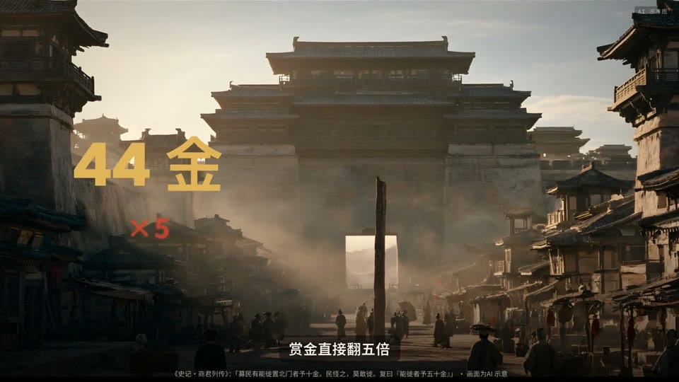
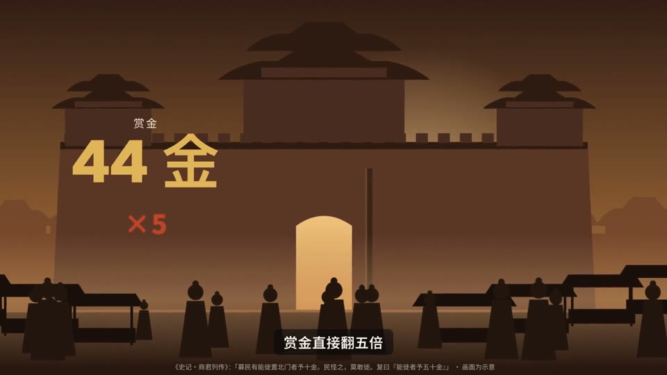
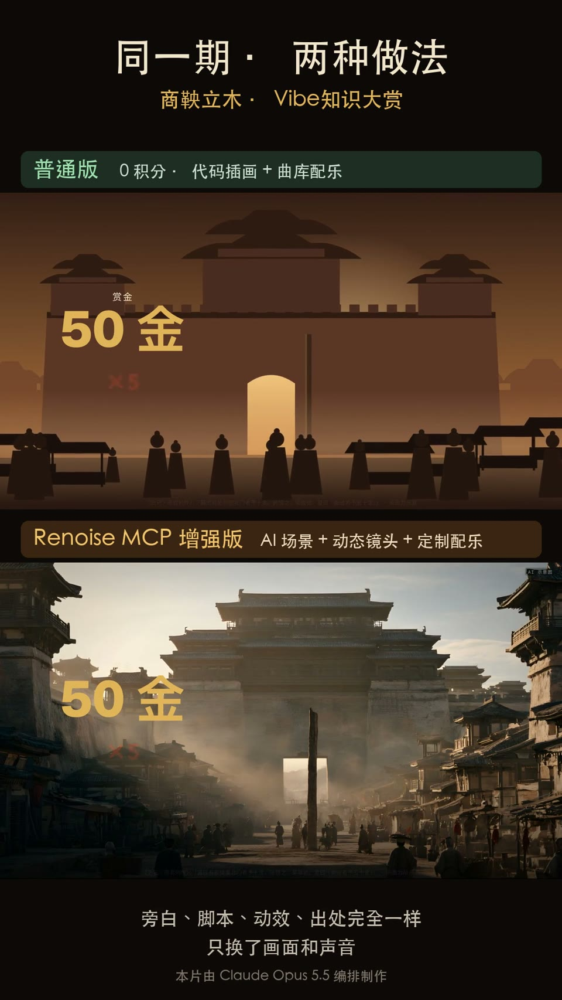
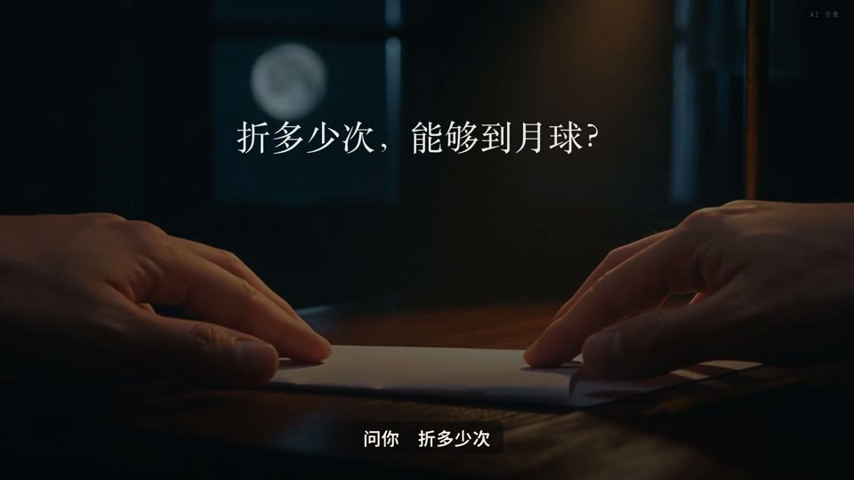
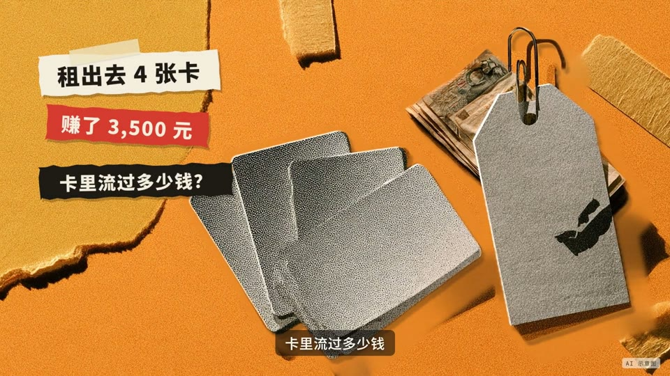
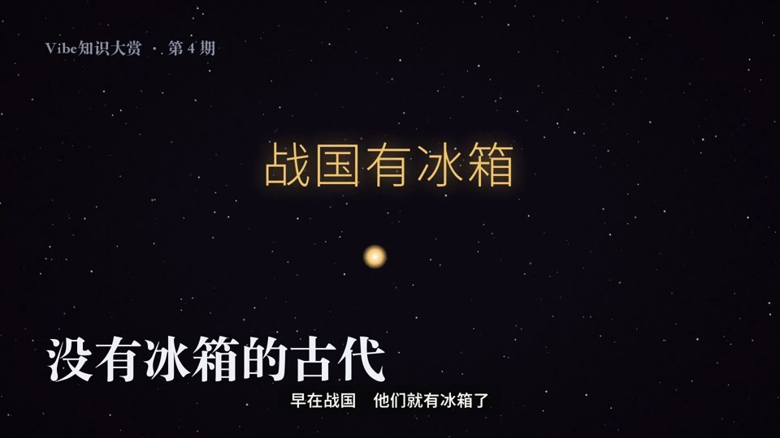
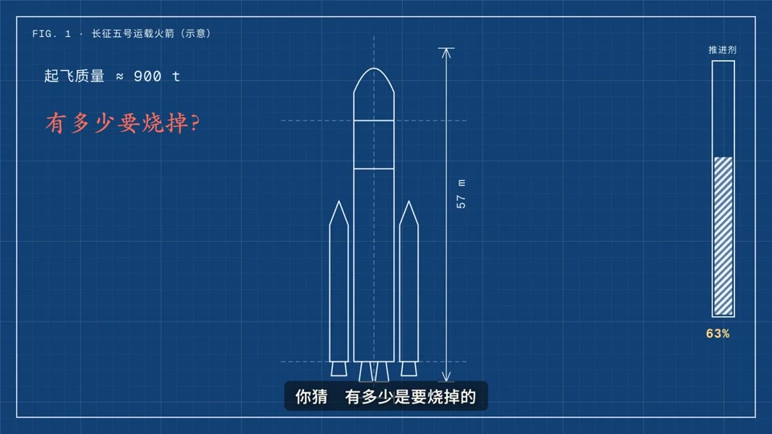
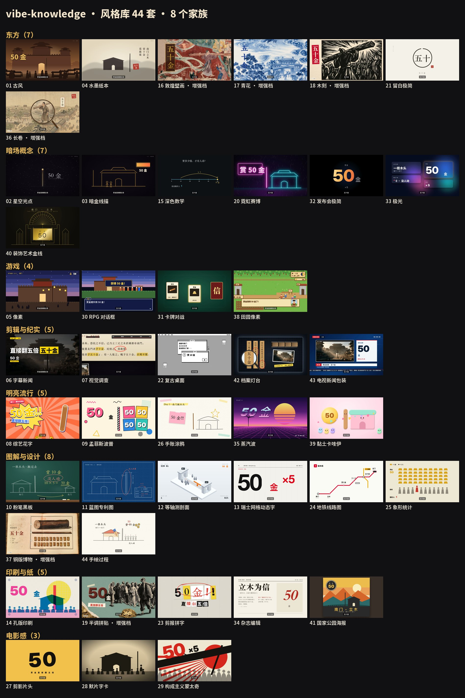

<div align="center">

# vibe-knowledge · Vibe Tri Thức Đại Thưởng

**Một điểm kiến thức → một đoạn phim ngắn tinh phẩm có lời dẫn, mỗi câu đều có xuất xứ.**<br>
Claude Code skill: chọn đề tài → kiểm chứng → viết kịch bản → lồng tiếng → dựng phim bằng code → 1080p60 → kiểm tra chất lượng → gói phát hành, toàn bộ làm xong trong cuộc trò chuyện.

[](LICENSE) [](skills/vibe-knowledge/SKILL.md) [](https://renoise.ai/mcp?utm_medium=xcom&utm_source=official)

[English](README.en.md) · [Xem phim mẫu](#xem-phim-mẫu) · [Thư viện phong cách](#thư-viện-phong-cách-44-bộ--8-họ) · [Nghe thử](#nghe-thử-giọng-mặc-định-và-bgm) · [Renoise](#renoise-nền-tảng-tạo-nội-dung-của-bản-nâng-cao) · [Cài đặt](#cài-đặt)


<sub>↑ Trích đoạn phim chớp nhoáng các phong cách. Bản đầy đủ 42 giây: <a href="https://github.com/andyhuo520/vibe-knowledge/releases/download/v1.0.0/style-flash-42s.mp4">style-flash-42s.mp4</a></sub>

</div>

---

## Xem phim mẫu

Bấm vào ảnh bìa để phát (video đặt ở [Release v1.0.0](https://github.com/andyhuo520/vibe-knowledge/releases/tag/v1.0.0)). Mọi hình ảnh đều do Claude Opus dàn dựng, code render từng khung hình; các cảnh gắn nhãn "nâng cao" dùng [Renoise](https://renoise.ai/mcp?utm_medium=xcom&utm_source=official) để tạo ảnh minh họa và cảnh quay động, trong phim đều có ghi chú "Minh họa AI".

<table>
<tr><td width="50%" valign="top"><a href="https://github.com/andyhuo520/vibe-knowledge/releases/download/v1.0.0/ep04b-no-fridge-gufeng.mp4"></a><br><b>Nếu bạn sống ở thời cổ đại không có tủ lạnh (bản cổ phong)</b><br><sub>2:05 · phim lựa chọn lưỡng nan · cổ phong · bản nâng cao hạng chuẩn (cảnh quay động Wan 3.0)</sub></td><td width="50%" valign="top"><a href="https://github.com/andyhuo520/vibe-knowledge/releases/download/v1.0.0/ep01-shangyang.mp4"></a><br><b>Thương Ưởng dựng cột gỗ: khiêng một cây gỗ thưởng năm mươi lạng vàng, bạn có khiêng không?</b><br><sub>2:32 · phim lựa chọn lưỡng nan · cổ phong · bản nâng cao</sub></td></tr>
<tr><td width="50%" valign="top"><a href="https://github.com/andyhuo520/vibe-knowledge/releases/download/v1.0.0/ep01-shangyang-base.mp4"></a><br><b>Thương Ưởng dựng cột gỗ (bản cơ bản, 0 điểm)</b><br><sub>2:32 · cùng một film.js, bản minh họa bằng code</sub></td><td width="50%" valign="top"><a href="https://github.com/andyhuo520/vibe-knowledge/releases/download/v1.0.0/ep01-tiers-compare.mp4"></a><br><b>Thương Ưởng dựng cột gỗ · so sánh hai bản trên dưới</b><br><sub>2:32 · bản cơ bản và bản nâng cao, lời dẫn và kịch bản hoàn toàn giống nhau</sub></td></tr>
<tr><td width="50%" valign="top"><a href="https://github.com/andyhuo520/vibe-knowledge/releases/download/v1.0.0/ep02-paper-to-moon.mp4"></a><br><b>Gấp một tờ giấy bao nhiêu lần thì chạm tới Mặt Trăng</b><br><sub>1:10 · phim khái niệm đoán đố · toán nền tối + xuyên thang đo · bản nâng cao hạng chuẩn</sub></td><td width="50%" valign="top"><a href="https://github.com/andyhuo520/vibe-knowledge/releases/download/v1.0.0/ep03-money-laundering.mp4"></a><br><b>Rửa tiền là gì</b><br><sub>1:31 · phim nguyên lý điểm đau · cắt dán bán sắc · bản nâng cao hạng nhẹ</sub></td></tr>
<tr><td width="50%" valign="top"><a href="https://github.com/andyhuo520/vibe-knowledge/releases/download/v1.0.0/ep04-no-fridge.mp4"></a><br><b>Nếu bạn sống ở thời cổ đại không có tủ lạnh</b><br><sub>3:12 · phim khái niệm đoán đố · điểm sáng sao trời · bản cơ bản 0 điểm (một cách kể khác cho cùng đề tài)</sub></td><td width="50%" valign="top"><a href="https://github.com/andyhuo520/vibe-knowledge/releases/download/v1.0.0/ep05-rocket.mp4"></a><br><b>Tên lửa bay lên trời như thế nào</b><br><sub>1:46 · phim khái niệm đoán đố · bản vẽ sáng chế xanh · bản nâng cao hạng chuẩn</sub></td></tr>
</table>

**Bộ phim mẫu phong cách** (mỗi phong cách diễn cùng một đoạn mở đầu "Thương Ưởng dựng cột gỗ", tiện so sánh ngang):

- [7 bộ đầu tiên (cổ phong, điểm sáng sao trời, nét vàng tối, thủy mặc giấy, pixel, tin tức phụ đề, điều tra trực quan)](https://github.com/andyhuo520/vibe-knowledge/releases/download/v1.0.0/styles-01-core7.mp4)
- [Dựng phim và phi hư cấu](https://github.com/andyhuo520/vibe-knowledge/releases/download/v1.0.0/styles-02-edit-doc.mp4)
- [8 bộ bổ sung các họ còn trống](https://github.com/andyhuo520/vibe-knowledge/releases/download/v1.0.0/styles-03.mp4)
- [Bản nâng cao: Đôn Hoàng, men xanh trắng, khắc gỗ, cắt dán bán sắc](https://github.com/andyhuo520/vibe-knowledge/releases/download/v1.0.0/styles-04-enhanced.mp4)
- [Đợt thứ năm, 8 bộ](https://github.com/andyhuo520/vibe-knowledge/releases/download/v1.0.0/styles-05.mp4)
- [Đợt thứ sáu, 8 bộ](https://github.com/andyhuo520/vibe-knowledge/releases/download/v1.0.0/styles-06.mp4)
- [Bản nâng cao: cuộn dài, bác vật bản đồng](https://github.com/andyhuo520/vibe-knowledge/releases/download/v1.0.0/styles-07-enhanced.mp4)
- [Nông trại pixel](https://github.com/andyhuo520/vibe-knowledge/releases/download/v1.0.0/styles-08-farm-pixel.mp4)
- [Đợt thứ chín, 5 bộ](https://github.com/andyhuo520/vibe-knowledge/releases/download/v1.0.0/styles-09.mp4)
- [Quá trình vẽ tay (bàn tay + nét bút cho bạn xem)](https://github.com/andyhuo520/vibe-knowledge/releases/download/v1.0.0/styles-10-sketch.mp4)

## Thư viện phong cách: 44 bộ · 8 họ



| Họ | Số lượng | Phong cách (bấm vào xem STYLE.md: phối màu, phông chữ, ngôn ngữ ống kính, đề tài phù hợp) |
|---|---|---|
| Phương Đông | 7 | [Cổ phong](skills/vibe-knowledge/styles/gufeng/STYLE.md), [Thuỷ mặc giấy](skills/vibe-knowledge/styles/paper/STYLE.md), [Bích họa Đôn Hoàng](skills/vibe-knowledge/styles/dunhuang/STYLE.md) (nâng cao), [Men xanh trắng](skills/vibe-knowledge/styles/qinghua/STYLE.md) (nâng cao), [Khắc gỗ](skills/vibe-knowledge/styles/woodcut/STYLE.md) (nâng cao), [Chừa trắng tối giản](skills/vibe-knowledge/styles/minimal/STYLE.md), [Cuộn dài](skills/vibe-knowledge/styles/scroll/STYLE.md) (nâng cao) |
| Khái niệm nền tối | 7 | [Điểm sáng sao trời](skills/vibe-knowledge/styles/starfield/STYLE.md), [Nét vàng tối](skills/vibe-knowledge/styles/darkgold/STYLE.md), [Toán nền tối](skills/vibe-knowledge/styles/darkmath/STYLE.md), [Neon Cyber](skills/vibe-knowledge/styles/neon/STYLE.md), [Tối giản phát hành](skills/vibe-knowledge/styles/keynote/STYLE.md), [Cực quang](skills/vibe-knowledge/styles/aurora/STYLE.md), [Đường vàng Art Deco](skills/vibe-knowledge/styles/deco/STYLE.md) |
| Game | 4 | [Pixel](skills/vibe-knowledge/styles/pixel/STYLE.md), [Hộp thoại RPG](skills/vibe-knowledge/styles/rpg/STYLE.md), [Đấu bài](skills/vibe-knowledge/styles/cards/STYLE.md), [Nông trại pixel](skills/vibe-knowledge/styles/farm/STYLE.md) |
| Dựng phim và phi hư cấu | 5 | [Tin tức phụ đề](skills/vibe-knowledge/styles/caption-news/STYLE.md), [Điều tra trực quan](skills/vibe-knowledge/styles/investigation/STYLE.md), [Desktop cổ điển](skills/vibe-knowledge/styles/desktop/STYLE.md), [Bàn đèn hồ sơ](skills/vibe-knowledge/styles/lighttable/STYLE.md), [Bao bì tin tức truyền hình](skills/vibe-knowledge/styles/tvnews/STYLE.md) |
| Tươi sáng đại chúng | 5 | [Chữ hoa tạp kỹ](skills/vibe-knowledge/styles/variety/STYLE.md), [Memphis Pop](skills/vibe-knowledge/styles/memphis/STYLE.md), [Sổ tay vẽ nguệch ngoạc](skills/vibe-knowledge/styles/journal/STYLE.md), [Vaporwave](skills/vibe-knowledge/styles/vapor/STYLE.md), [Đất sét Kawaii](skills/vibe-knowledge/styles/clay/STYLE.md) |
| Đồ giải và thiết kế | 8 | [Bảng đen phấn trắng](skills/vibe-knowledge/styles/chalk/STYLE.md), [Bản vẽ bằng sáng chế xanh](skills/vibe-knowledge/styles/blueprint/STYLE.md), [Mặt cắt đẳng cự](skills/vibe-knowledge/styles/isometric/STYLE.md), [Chữ động lưới Thuỵ Sĩ](skills/vibe-knowledge/styles/swiss/STYLE.md), [Sơ đồ tuyến tàu điện](skills/vibe-knowledge/styles/metro/STYLE.md), [Thống kê hình tượng](skills/vibe-knowledge/styles/isotype/STYLE.md), [Bác vật bản đồng](skills/vibe-knowledge/styles/copper/STYLE.md) (nâng cao), [Vẽ tay quá trình](skills/vibe-knowledge/styles/sketch/STYLE.md) |
| In ấn và giấy | 5 | [In Risograph](skills/vibe-knowledge/styles/riso/STYLE.md), [Cắt dán bán sắc](skills/vibe-knowledge/styles/collage/STYLE.md) (nâng cao), [Cắt báo ghép chữ](skills/vibe-knowledge/styles/ransom/STYLE.md), [Tạp chí biên tập](skills/vibe-knowledge/styles/editorial/STYLE.md), [Poster công viên quốc gia](skills/vibe-knowledge/styles/poster/STYLE.md) |
| Điện ảnh | 3 | [Mở đầu bóng đen](skills/vibe-knowledge/styles/titles/STYLE.md), [Thẻ chữ phim câm](skills/vibe-knowledge/styles/silent/STYLE.md), [Dựng phim chủ nghĩa kiến tạo](skills/vibe-knowledge/styles/constructivist/STYLE.md) |

"Nâng cao" = cần Renoise tạo ảnh (khoảng 8 điểm / đoạn), còn lại toàn bộ do code tạo, 0 điểm. Sau khi đưa ra đề tài, `recommend.py` sẽ đề xuất 3 phong cách; bạn cũng có thể bắt đầu từ trang trắng để định ra một phong cách của riêng mình (`references/09-style-studio.md`).

## Nghe thử: giọng mặc định và BGM

| Âm thanh | Giải thích |
|---|---|
| [mix-demo-voice-plus-bgm.m4a](docs/audio/mix-demo-voice-plus-bgm.m4a) | Hiệu quả trộn âm của thành phẩm: lời dẫn + BGM mặc định + hiệu ứng âm thanh (24 giây đầu bản B của kỳ 04) |
| [vibe-bgm.m4a](skills/vibe-knowledge/assets/music/vibe-bgm.m4a) | BGM mặc định (112,9 BPM, 160 giây), video nào cũng dùng |

**BGM là bắt buộc**: khi trộn âm nếu film.js không đặt BGM thì sẽ tự cắt một bản theo độ dài phim để bổ sung; các bản nhạc nguyên đoạn khác bị vô hiệu hóa; âm lượng được hiệu chỉnh thống nhất về "khi nói thấp hơn giọng người 10 dB". Chỉ khi người dùng yêu cầu rõ ràng mới đổi bài (mục nhạc ghi `bgm: true, user_request: "nguyên văn người dùng"`).

## Làm một kỳ như thế nào

| Bước | Làm gì |
|---|---|
| ① Chọn đề tài | Trong 3 giây có khiến người ta đoán / chọn trước được không? Có đạo cụ xuyên suốt cả phim không? Có đảo ngược không? |
| **Xác nhận 1** | Đề tài, một trong 6 bản gốc, **thời lượng** (theo độ phức tạp chia bốn hạng: lướt nhanh / giảng kỹ / chuẩn / đào sâu, mỗi hạng ghi rõ nói chi tiết đến đâu, phải cắt bỏ gì), phong cách, bậc |
| ② Tra cứu | Danh sách sự thật `facts.md`: mỗi con số, tên người, năm, trích dẫn đều có xuất xứ; khi các cách nói có bất đồng thì liệt kê song song hai thuyết |
| ③ Viết | Viết lời dẫn theo bản gốc → sub-agent rà soát đối kháng (hook, xuất xứ, số chữ) → sửa |
| **Xác nhận 2** | Xem bản thảo lời dẫn + phân cảnh (bản nâng cao kèm danh sách cảnh quay và báo giá Renoise), đồng ý rồi mới tạo |
| ④ Lồng tiếng | Giọng Google Gemini TTS + căn chỉnh từng chữ (OpenAI whisper-1 qua API) + đọc lại kiểm tra (cùng bản phiên âm đó) + hậu kỳ giọng (tùy chọn) |
| ⑤ Dàn dựng | `film.js`: thư viện thành phần `know.js` (đẩy kéo ảnh minh họa, video từng khung hình, từ khóa, bộ đếm, cổ văn viết dọc, chú thích xuất xứ, nút lưỡng nan, con dấu, hình mặt cắt nét…) |
| ⑥ Render | Ghi hình từng khung 1080p60 → trộn âm (BGM bắt buộc, hiệu chỉnh theo giọng người) → ghép ảnh bìa thành khung hình đầu |
| ⑦ Kiểm tra chất lượng | Contact sheet + đọc lại OCR đối chiếu facts.md + độ ồn + phát hiện đóng băng + phát hiện BGM |
| **Xác nhận 3** | Xem thành phẩm → gói phát hành (tiêu đề, chủ đề, mô tả, ảnh bìa) |

**Sản xuất hai bậc**: bản cơ bản 0 điểm (Opus tự viết minh họa SVG phân lớp, hạt, thành phần dữ liệu); bản nâng cao chỉ giao cho Renoise những cảnh code làm không tốt (cảnh chân thực, 1–3 khoảnh khắc cần được nhớ nhất), mỗi lần báo giá trước, bạn đồng ý rồi mới tạo. Cùng một film.js dùng chung cho hai bậc.

**Sáu bản gốc**: phim khái niệm đoán đố, phim lựa chọn lưỡng nan, phim nguyên lý điểm đau, phim một mạch chính, phim vượt ải, phim luân chuyển sáu mặt (`references/01-templates.md`).

## Renoise: nền tảng tạo nội dung của bản nâng cao

**[Renoise](https://renoise.ai/mcp?utm_medium=xcom&utm_source=official)** là nền tảng tạo video, ảnh, âm thanh bằng AI, kết nối thẳng vào các Agent như Claude Code, Codex qua MCP. Chỉ một tài khoản là dùng được các mô hình như Midjourney, GPT Image, Nano Banana, Seedance 2.5, Wan 3.0, Kling, Grok Video, Lyria, hiệu ứng âm thanh ElevenLabs, tạo trực tiếp trong cuộc trò chuyện.

Trong vibe-knowledge, Renoise chỉ phụ trách mấy cảnh code làm không tốt của **bản nâng cao**: ảnh minh họa cảnh thời đại chân thực, 1–3 cảnh quay động cần được nhớ nhất, một vài hiệu ứng âm thanh. Các hình ảnh còn lại vẫn vẽ bằng code. **Bản cơ bản hoàn toàn không cần Renoise, 0 điểm vẫn xuất được phim.**

- **Báo giá trước, bạn gật đầu mới tạo**: mỗi kỳ đều liệt kê cho bạn các cảnh sẽ tạo, mô hình, prompt và tổng giá `estimate_cost`, bạn đồng ý rõ ràng trong cuộc trò chuyện mới gửi.
- **Tốn bao nhiêu biết trước**: kỳ 01 "Thương Ưởng dựng cột gỗ" bản nâng cao dùng 246 điểm (10 ảnh minh họa Midjourney + 2 cảnh quay động Wan + nhạc nền + 5 hiệu ứng âm thanh); bản nâng cao thường ở mức nhẹ ≈25–40 / chuẩn ≈250–300 / hàng đầu ≈600–700 điểm.
- **Ghi chú trong phim**: các hình do Renoise tạo đều gắn nhãn "Minh họa AI".

**Chưa có tài khoản? Trước hết vào [renoise.ai](https://renoise.ai/mcp?utm_medium=xcom&utm_source=official) đăng ký**. Đăng nhập đều hoàn tất trong trình duyệt, không cần sao chép API key nào. Sau đó kết nối theo Agent bạn dùng:

| Đang dùng | Kết nối thế nào |
|---|---|
| **Claude Code** | Lần lượt nhập `/plugin marketplace add ArcoCodes/renoise-plugins-official`, `/plugin install renoise@renoise-plugins-official`, lần gọi đầu tiên đăng nhập trên trình duyệt |
| **Claude desktop / claude.ai** | Cài đặt → Trình kết nối (Connectors) → **Add custom connector** → tên `Renoise`, địa chỉ `https://renoise.ai/api/public/mcp` |
| **Codex** | `codex mcp add renoise --url https://renoise.ai/api/public/mcp`, rồi `codex mcp login renoise` |
| **OpenClaw** | `openclaw plugins install renoise --marketplace ArcoCodes/renoise-plugins-official` |
| **WorkBuddy, Cursor, Windsurf, Cline, Doubao, Qwen, Nano Work…** | Thêm máy chủ MCP từ xa, địa chỉ `https://renoise.ai/api/public/mcp` (cấu hình thường gặp: `{"mcpServers":{"renoise":{"url":"https://renoise.ai/api/public/mcp"}}}`) |

Cách cài mới nhất của chính thức: [renoise.ai/plugin](https://renoise.ai/plugin). Cài xong hỏi Agent một câu "kiểm tra số dư Renoise của tôi", tra được là đã kết nối.

## Cài đặt

```bash
git clone https://github.com/andyhuo520/vibe-knowledge.git
cp -R vibe-knowledge/skills/vibe-knowledge vibe-knowledge/skills/ai-teardown ~/.claude/skills/
```

- `vibe-knowledge` là phần chính; `ai-teardown` cung cấp engine render cine, tạo không gian làm việc và script lồng tiếng, cả hai đều phải cài.
- Python dùng để render: `python3 -m venv ~/.venvs/cine && ~/.venvs/cine/bin/pip install numpy scipy pillow playwright && ~/.venvs/cine/bin/python -m playwright install chromium-headless-shell`; sau đó `export CINE_PY=~/.venvs/cine/bin/python`.
- `ffmpeg`; kiểm tra chất lượng OCR dùng Vision có sẵn của macOS (cần `swiftc`).
- Lồng tiếng: Google Gemini TTS (mặc định model `gemini-3.8-flash-tts`, giọng `Sulafat`), đặt khóa vào biến môi trường `GOOGLE_API_KEY` hoặc `~/.config/ai-teardown/gemini.env` (**không ghi vào file dự án**). Muốn đổi giọng: chọn tên giọng có sẵn của Gemini (ví dụ Sulafat, Gacrux) trong `narration.json`; không viết `director` (model đọc to cả chỉ dẫn), không còn nhân bản giọng.
- Căn chỉnh từng chữ và đọc lại kiểm tra: OpenAI `whisper-1` qua API, đặt khóa vào `OPENAI_API_KEY` hoặc `~/.config/ai-teardown/openai.env` (**không ghi vào file dự án**). Mỗi lần lồng tiếng tốn thêm phí OpenAI (1–2 lần gọi mỗi nhịp, có cache); `whisper-1` sẽ bị OpenAI tắt ngày 26/02/2027. Không còn cần whisper.cpp trên máy.
- Bản nâng cao (tùy chọn): [Renoise MCP](https://renoise.ai/mcp?utm_medium=xcom&utm_source=official), đăng ký và kết nối xem mục [Renoise](#renoise-nền-tảng-tạo-nội-dung-của-bản-nâng-cao) ở trên.

Sau đó nói trong Claude Code:

> Làm một kỳ Vibe Tri Thức Đại Thưởng: vì sao sổ sách giả luôn bị con số 1 tố giác?

Lần đầu dùng sẽ mở trước "Cẩm nang phong cách" cục bộ, giới thiệu bản gốc, phong cách và bậc.

## Thư mục

```
skills/vibe-knowledge/   phần chính: SKILL.md, references/ (14 tài liệu quy chuẩn và bẫy), styles/ (44 phong cách), kit/know.js, tools/, templates/, assets/ (BGM mặc định, giọng mặc định)
skills/ai-teardown/      engine cine (render từng khung hình bằng three.js), phông chữ, bộ biểu tượng, script tạo không gian làm việc và lồng tiếng
docs/                    ảnh bìa, tường phong cách, ảnh động, âm thanh nghe thử dùng cho README
```

## Lời cảm ơn

Khi làm dự án này đã tham khảo các dự án mã nguồn mở như lemo-opuscar, huashu-art-motion, paper2video, Paper-Cut, LuZhong-Li/vibe-knowledge-video-skill, earshot. Mỗi dự án tham khảo gì, dùng ở đâu, giấy phép gì, đều được liệt kê trong [ACKNOWLEDGEMENTS.md](ACKNOWLEDGEMENTS.md). Nếu có chỗ không chính xác, hoan nghênh mở issue, chúng tôi sẽ sửa kịp thời.

## Giấy phép

Code mã nguồn mở theo [MIT](LICENSE). Giải thích về video mẫu, ảnh minh họa và cảnh quay động do AI tạo, BGM mặc định và giọng mặc định xem [NOTICE.md](NOTICE.md); thành phần bên thứ ba xem [THIRD_PARTY.md](THIRD_PARTY.md); các dự án mã nguồn mở đã tham khảo xem [ACKNOWLEDGEMENTS.md](ACKNOWLEDGEMENTS.md).

Tác giả [@Berryxia](https://x.com/berryxia) · dàn dựng và sản xuất bằng Claude Code (Claude Opus)
